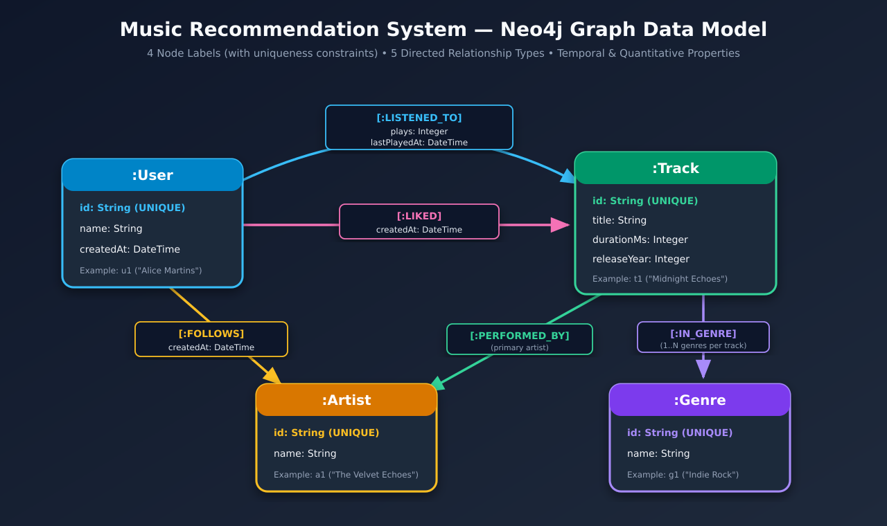

# Music Recommendation System with Neo4j

A Spotify-inspired **Graph-Based Music Recommendation System** built exclusively with **Neo4j Community Edition** and **Cypher**. All domain modeling, data ingestion, analytical queries, and personalized recommendation engines run directly inside the graph database without external backend services, REST APIs, or frontend layers.

## Project Overview

Music streaming platforms rely on rich networks of interactions—users listening to tracks, liking songs, following artists, and exploring genres. This project demonstrates how to model those interactions natively as a property graph in **Neo4j** and express multi-hop recommendation strategies directly in **Cypher**:

- **Property Graph Data Modeling:** Nodes (`User`, `Track`, `Artist`, `Genre`), directed relationships (`LISTENED_TO`, `LIKED`, `FOLLOWS`, `PERFORMED_BY`, `IN_GENRE`), quantitative weights (`plays`), and timestamps (`createdAt`, `lastPlayedAt`).
- **Idempotent Data Pipelines:** Automatic creation of uniqueness constraints and CSV ingestion using `LOAD CSV WITH HEADERS` and `MERGE`.
- **Pure-Cypher Recommendation Engines:** Collaborative Filtering, Artist-Based Discovery, and Genre-Affinity Content Filtering.



---

## Running the Project with Docker Compose

### 1. Configure Environment Variables

Copy `.env.example` to `.env`:

```bash
cp .env.example .env
```

Default credentials in `.env`:
- **Username (`NEO4J_USER`):** `neo4j`
- **Password (`NEO4J_PASSWORD`):** `music_graph_pass`
- **Neo4j Browser:** `http://localhost:7474`
- **Bolt URI:** `bolt://localhost:7687`

### 2. Start the Environment

Run a single command to start Neo4j and automatically initialize the database:

```bash
docker compose up -d
```

> **Note:** As soon as the `neo4j` container becomes healthy, the `neo4j-init` service automatically executes `cypher/00_constraints.cypher` and imports all CSV files from `data/sample/` via `cypher/01_import_data.cypher`.

You can check the initialization logs with:

```bash
docker compose logs -f neo4j-init
```

To stop or reset the environment at any time:

```bash
# Stop containers (preserves database volume)
docker compose down

# Wipe persisted volumes and recreate from scratch
docker compose down -v && docker compose up -d
```

---

## Executing Queries

### Option A — Interactive Visual Exploration in Neo4j Browser

1. Open **http://localhost:7474** in your browser.
2. Sign in with username `neo4j` and password `music_graph_pass`.
3. Open [`cypher/05_browser_showcase_queries.cypher`](cypher/05_browser_showcase_queries.cypher) and copy-paste any query block directly into the top prompt of Neo4j Browser (no prior parameter setup needed).

If you want to run individual queries from [`cypher/03_business_queries.cypher`](cypher/03_business_queries.cypher) or [`cypher/04_recommendations.cypher`](cypher/04_recommendations.cypher) in Neo4j Browser, define the user parameters first in the Browser command bar:

```cypher
:param userId => 'u1'
:param otherUserId => 'u2'
```

### Option B — Run Query Scripts via Terminal (`docker compose` or `make`)

Using **Docker Compose** directly:

```bash
# 1. Basic exploration queries (02_basic_queries.cypher)
docker compose exec -T neo4j cypher-shell -u neo4j -p music_graph_pass -P "userId => 'u1'" -f /cypher/02_basic_queries.cypher

# 2. Business & similarity queries (03_business_queries.cypher)
docker compose exec -T neo4j cypher-shell -u neo4j -p music_graph_pass -P "userId => 'u1'" -P "otherUserId => 'u2'" -f /cypher/03_business_queries.cypher

# 3. Recommendation strategies A, B, and C (04_recommendations.cypher)
docker compose exec -T neo4j cypher-shell -u neo4j -p music_graph_pass -P "userId => 'u1'" -f /cypher/04_recommendations.cypher

# 4. All 12 self-contained showcase queries (05_browser_showcase_queries.cypher)
docker compose exec -T neo4j cypher-shell -u neo4j -p music_graph_pass -f /cypher/05_browser_showcase_queries.cypher
```

Or using the **`Makefile`** shortcuts:

```bash
make basic            # Run cypher/02_basic_queries.cypher
make business         # Run cypher/03_business_queries.cypher
make recommendations  # Run cypher/04_recommendations.cypher
make showcase         # Run cypher/05_browser_showcase_queries.cypher
make shell            # Open an interactive cypher-shell session
```
