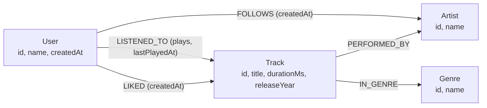
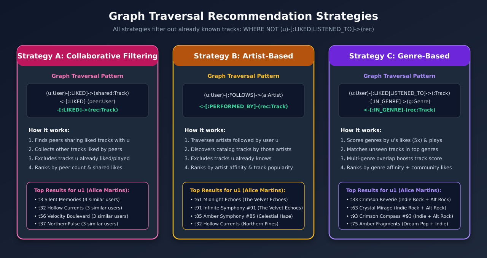

# Music Recommendation System with Neo4j

A Spotify-inspired **Graph-Based Music Recommendation System** built exclusively with **Neo4j Community Edition** and **Cypher**. All domain modeling, data ingestion, analytical queries, and personalized recommendation engines run directly inside the graph database without external backend services, REST APIs, or frontend layers.

---

## Table of Contents

1. [Project Overview](#1-project-overview)
2. [Problem Statement](#2-problem-statement)
3. [Why Neo4j?](#3-why-neo4j)
4. [Architecture](#4-architecture)
5. [Graph Data Model](#5-graph-data-model)
6. [Dataset Description](#6-dataset-description)
7. [Prerequisites](#7-prerequisites)
8. [Installation](#8-installation)
9. [Docker Compose Setup](#9-docker-compose-setup)
10. [Database Initialization](#10-database-initialization)
11. [Data Import](#11-data-import)
12. [Basic Cypher Queries](#12-basic-cypher-queries)
13. [Business Queries](#13-business-queries)
14. [Recommendation Strategies](#14-recommendation-strategies)
15. [Expected Results](#15-expected-results)
16. [Troubleshooting](#16-troubleshooting)
17. [Future Improvements](#17-future-improvements)

---

## 1. Project Overview

Music streaming platforms rely on rich networks of interactions—users listening to tracks, liking songs, following artists, and exploring genres. This project demonstrates how to model those interactions natively as a property graph in **Neo4j** and express multi-hop recommendation strategies directly in **Cypher**.

Key capabilities demonstrated:
- **Property Graph Data Modeling:** Designing nodes, directed relationships, quantitative weights (`plays`), and timestamps (`createdAt`, `lastPlayedAt`).
- **Idempotent Data Pipelines:** Loading relational CSV datasets into a graph structure using `LOAD CSV WITH HEADERS`, uniqueness constraints, and `MERGE`.
- **Graph Analytics & Business Intelligence:** Extracting popularity indices, user taste similarity (Jaccard + overlap), and anomalous engagement patterns (high plays vs. low likes).
- **Pure-Cypher Recommendation Engines:** Implementing Collaborative Filtering, Artist-Based Discovery, and Genre-Affinity Content Filtering.
- **Reproducible Containerized Environment:** One-command orchestration with Docker Compose and GNU Make.

---

## 2. Problem Statement

Traditional relational databases struggle when computing personalized recommendations over deeply connected behavioral data. Answering questions such as:
- *"Which unseen tracks are liked by users who share musical tastes with Alice?"*
- *"Which artists are most followed by peers with similar track preferences?"*
- *"Which tracks match a user's weighted genre affinity while excluding everything they have already heard or liked?"*

requires multiple expensive self-joins across many-to-many junction tables in SQL. As hop depth increases (3 to 5 hops), relational query plans degrade and become difficult to maintain. We need a storage and query engine where **relationships are first-class citizens** and multi-hop traversals execute in milliseconds.

---

## 3. Why Neo4j?

1. **Index-Free Adjacency:** Each node maintains direct physical pointers to its adjacent nodes, making multi-hop graph traversals (`User -> Track <- User -> Track -> Artist`) proportional to the subgraph explored rather than the total table size.
2. **Expressive Pattern Matching with Cypher:** ASCII-art pattern syntax (`(u:User)-[:LIKED]->(t:Track)<-[:LIKED]-(peer:User)`) directly mirrors the domain diagram, keeping recommendation logic concise, auditable, and self-documenting.
3. **Flexible Relationship Properties:** Quantitative signals like play counts (`plays`) and recency (`lastPlayedAt`) live naturally on the `[:LISTENED_TO]` edge while keeping explicit preferences (`[:LIKED]`) decoupled.
4. **Visual Graph Exploration:** **Neo4j Browser** renders query results as interactive node-link diagrams out of the box, enabling immediate visual validation of similarity clusters and recommendation paths.

---

## 4. Architecture

The system intentionally avoids external application servers to keep all logic transparent and reproducible inside Neo4j:

| Technology | Responsibility |
|---|---|
| **Neo4j Community Edition (`5.26.0-community`)** | Graph database storage and execution engine |
| **Cypher** | Schema constraints, CSV ingestion, analytics, and recommendation queries |
| **Docker & Docker Compose** | Containerization, volume persistence, and environment isolation |
| **CSV (`data/sample/*.csv`)** | Deterministic synthetic dataset for demonstration |
| **Neo4j Browser (`http://localhost:7474`)** | Interactive UI to run Cypher queries and visualize subgraphs |
| **GNU Make (`Makefile`)** | CLI automation for lifecycle, schema creation, import, and reset |

### Exposed Services & Ports

- **Neo4j Browser (HTTP):** `http://localhost:7474`
- **Bolt Protocol:** `bolt://localhost:7687`

### Repository Structure

```text
music-recommendation-neo4j/
│
├── docker-compose.yml
├── .env.example
├── .gitignore
├── README.md
├── task.md
├── Makefile
│
├── data/
│   └── sample/
│       ├── users.csv
│       ├── artists.csv
│       ├── genres.csv
│       ├── tracks.csv
│       ├── listens.csv
│       ├── likes.csv
│       └── follows.csv
│
├── cypher/
│   ├── 00_constraints.cypher
│   ├── 01_import_data.cypher
│   ├── 02_basic_queries.cypher
│   ├── 03_business_queries.cypher
│   └── 04_recommendations.cypher
│
└── docs/
    ├── graph-model.png
    ├── recommendations.png
    └── examples/
        └── README.md
```

---

## 5. Graph Data Model




### Node Labels

| Label | Properties | Uniqueness Constraint |
|---|---|---|
| `User` | `id` (String), `name` (String), `createdAt` (DateTime) | `user_id_unique` on `u.id` |
| `Track` | `id` (String), `title` (String), `durationMs` (Integer), `releaseYear` (Integer) | `track_id_unique` on `t.id` |
| `Artist` | `id` (String), `name` (String) | `artist_id_unique` on `a.id` |
| `Genre` | `id` (String), `name` (String) | `genre_id_unique` on `g.id` |

### Relationship Types

| Source | Relationship | Target | Properties | Semantics |
|---|---|---|---|---|
| `User` | `LISTENED_TO` | `Track` | `plays` (Integer), `lastPlayedAt` (DateTime) | Aggregated listening history per `(User, Track)` pair |
| `User` | `LIKED` | `Track` | `createdAt` (DateTime) | Explicit positive preference (independent of play history) |
| `User` | `FOLLOWS` | `Artist` | `createdAt` (DateTime) | Explicit subscription to an artist |
| `Track` | `PERFORMED_BY` | `Artist` | *None* | Links a track to its primary artist |
| `Track` | `IN_GENRE` | `Genre` | *None* | Classifies a track into one or more musical genres |

### Key Modeling Decisions

1. **Aggregated `LISTENED_TO` vs. Individual Play Events:** Instead of creating a separate relationship or event node for every single stream, `LISTENED_TO` stores `plays` (count) and `lastPlayedAt` (timestamp). This prevents supernode edge explosion while preserving frequency and recency signals for recommendation scoring.
2. **Decoupled `LIKED` and `LISTENED_TO`:** A user can like a song they heard on the radio without having streamed it in the app, or stream a background track dozens of times without liking it. Keeping `LIKED` separate from `LISTENED_TO` enables richer business queries (such as detecting high-play/low-like passive tracks).
3. **Multi-Genre Support (`IN_GENRE`):** Tracks in `tracks.csv` can reference one or multiple semicolon-separated genres (e.g., `g1;g9`), which `01_import_data.cypher` unwinds via `UNWIND split(row.genreIds, ';')` into individual `[:IN_GENRE]` edges.

---

## 6. Dataset Description

The synthetic dataset in `data/sample/` is deterministic, referentially consistent, and designed with realistic taste clusters so similarity and recommendation queries yield meaningful results:

| CSV File | Entity / Interaction | Row Count | Minimum Required | Description |
|---|---|---:|---:|---|
| `users.csv` | `User` | **20** | 20 | `u1` (`Alice Martins`) through `u20` (`Vinicius Correia`), grouped into 4 taste cohorts |
| `artists.csv` | `Artist` | **30** | 30 | `a1` (`The Velvet Echoes`) through `a30` (`Deep Cosmos`), 3 artists per primary genre |
| `genres.csv` | `Genre` | **10** | 10 | `g1` (`Indie Rock`), `g2` (`Synthwave`), `g3` (`Alternative Rock`), `g4` (`Deep House`), `g5` (`Lo-Fi Hip Hop`), `g6` (`Neo Soul`), `g7` (`Contemporary Jazz`), `g8` (`Folk Acoustic`), `g9` (`Dream Pop`), `g10` (`Ambient Electronic`) |
| `tracks.csv` | `Track` | **100** | 100 | `t1` through `t100`, each linked to 1 primary artist and 1–2 genres (`133` total `IN_GENRE` edges) |
| `listens.csv` | `LISTENED_TO` | **257** | 200 | Unique `(userId, trackId)` listening histories with `plays` and `lastPlayedAt` |
| `likes.csv` | `LIKED` | **161** | 100 | Unique `(userId, trackId)` likes with `createdAt` |
| `follows.csv` | `FOLLOWS` | **90** | 50 | Unique `(userId, artistId)` artist subscriptions with `createdAt` |

### User Taste Cohorts

- **Cohort 1 (`u1`–`u5`):** Fans of *Indie Rock (`g1`)*, *Alternative Rock (`g3`)*, and *Dream Pop (`g9`)*. `u1` (`Alice Martins`) shares liked tracks with `u2`, `u3`, `u4`, and `u5`, while leaving several cohort-favorite tracks (`t3`, `t32`, `t37`, `t38`, `t56`, `t61`) unseen by `u1` for recommendation testing.
- **Cohort 2 (`u6`–`u10`):** Fans of *Synthwave (`g2`)*, *Deep House (`g4`)*, and *Ambient Electronic (`g10`)*.
- **Cohort 3 (`u11`–`u15`):** Fans of *Lo-Fi Hip Hop (`g5`)*, *Neo Soul (`g6`)*, and *Contemporary Jazz (`g7`)*.
- **Cohort 4 (`u16`–`u20`):** Fans of *Folk Acoustic (`g8`)* with crossover into *Indie Rock (`g1`)* and *Dream Pop (`g9`)*.

---

## 7. Prerequisites

- **Docker Engine** (`>= 20.10`)
- **Docker Compose** (`v2+`)
- **GNU Make** (optional, for shortcut commands)
- A modern web browser to access **Neo4j Browser** at `http://localhost:7474`

No local installation of Java, Neo4j, Python, or Node.js is required.

---

## 8. Installation

1. **Clone the repository:**

   ```bash
   git clone <repository-url>
   cd music-recommendation-neo4j
   ```

2. **Create your `.env` file from `.env.example`:**

   ```bash
   cp .env.example .env
   ```

   Inspect `.env` (Neo4j requires passwords to be at least 8 characters long):

   ```dotenv
   NEO4J_USER=neo4j
   NEO4J_PASSWORD=music_graph_pass
   NEO4J_HTTP_PORT=7474
   NEO4J_BOLT_PORT=7687
   ```

---

## 9. Docker Compose Setup

Start the Neo4j container in the background:

```bash
make up
# Or directly via Docker Compose:
docker compose up -d
```

Check container readiness and logs:

```bash
docker compose ps
make logs
```

Wait until the container health status shows `healthy` (typically 15–25 seconds). The `docker-compose.yml` mounts:
- `neo4j_data:/data` — Persistent database storage across container restarts.
- `neo4j_logs:/logs` — Persistent Neo4j server logs.
- `./data/sample:/var/lib/neo4j/import` — CSV import directory for `LOAD CSV`.
- `./cypher:/cypher:ro` — Read-only Cypher scripts directory inside the container.

---

## 10. Database Initialization

Apply the node uniqueness constraints (`cypher/00_constraints.cypher`):

```bash
make constraints
# Or directly:
docker compose exec -T neo4j cypher-shell -u "$NEO4J_USER" -p "$NEO4J_PASSWORD" -f /cypher/00_constraints.cypher
```

This creates four `IS UNIQUE` constraints (`IF NOT EXISTS`) on:
- `User.id`
- `Artist.id`
- `Genre.id`
- `Track.id`

---

## 11. Data Import

Import the CSV dataset (`cypher/01_import_data.cypher`):

```bash
make import
# Or directly:
docker compose exec -T neo4j cypher-shell -u "$NEO4J_USER" -p "$NEO4J_PASSWORD" -f /cypher/01_import_data.cypher
```

The ingestion pipeline is **fully idempotent**:
- Re-running `make import` uses `MERGE` on stable entity IDs and relationship endpoints, updating properties in place without creating duplicate nodes or parallel relationships.
- Numeric fields (`durationMs`, `releaseYear`, `plays`) are cast via `toInteger()`, and ISO-8601 timestamps (`createdAt`, `lastPlayedAt`) are cast via `datetime()`.

---

## 12. Basic Cypher Queries

File: [`cypher/02_basic_queries.cypher`](cypher/02_basic_queries.cypher)

Includes 7 foundational queries:
1. **List all users** ordered by registration timestamp.
2. **List tracks and their primary artists** with release year and duration in seconds.
3. **List tracks grouped by genre** with total count and sample titles.
4. **List the most followed artists** ranked by follower count.
5. **List the most played genres** ranked by sum of `plays` and unique listeners.
6. **List the most played tracks** ranked by total plays.
7. **Consult a user's musical history** (`LISTENED_TO` plays + whether the track is `LIKED`).

Run via CLI:

```bash
docker compose exec -T neo4j cypher-shell -u "$NEO4J_USER" -p "$NEO4J_PASSWORD" -P "userId => 'u1'" -f /cypher/02_basic_queries.cypher
```

---

## 13. Business Queries

File: [`cypher/03_business_queries.cypher`](cypher/03_business_queries.cypher)

Before executing user-parameterized queries in **Neo4j Browser**, set the session parameters:

```cypher
:param userId => 'u1'
:param otherUserId => 'u2'
```

Queries included:
1. **Most Popular Artists (`Query 1`):** Combines follower count (`5x`), unique track likers (`3x`), and total plays (`1x`) into a composite `popularityScore`.
2. **Most Popular Genres (`Query 2`):** Ranks genres by unique listeners, unique likers, and total stream volume.
3. **Users with Similar Musical Tastes (`Query 3`):** Finds peers who liked the same tracks as `$userId` and calculates both raw overlap (`sharedLikes`) and `jaccardSimilarity`.
4. **Shared Tracks Between Two Users (`Query 4`):** Lists all tracks that both `$userId` and `$otherUserId` have interacted with (`LIKED` or `LISTENED_TO`).
5. **Artists Most Followed by Similar Users (`Query 5`):** Identifies peers sharing at least 2 liked tracks with `$userId` and ranks the artists followed by those peers (flagging whether `$userId` already follows them).
6. **High Plays but Low Likes (`Query 6`):** Detects passive/background tracks (`totalPlays >= 40` and `totalLikes <= 2`) and computes their `likeToPlayRatio`.

Run via CLI:

```bash
docker compose exec -T neo4j cypher-shell -u "$NEO4J_USER" -p "$NEO4J_PASSWORD" -P "userId => 'u1'" -P "otherUserId => 'u2'" -f /cypher/03_business_queries.cypher
```

---

## 14. Recommendation Strategies

File: [`cypher/04_recommendations.cypher`](cypher/04_recommendations.cypher)



All three strategies strictly exclude tracks already known by the target user (`WHERE NOT (u)-[:LIKED|LISTENED_TO]->(rec)`):

### Strategy A — Collaborative Filtering

Finds peer users who liked tracks in common with `$userId`, discovers other tracks liked by those peers, groups by candidate track, and orders by the number of similar users who liked the track (`similarUsersCount`) and weighted overlap (`collaborativeScore`).

### Strategy B — Artist-Based Recommendation

Traverses `(:User {id: $userId})-[:FOLLOWS]->(a:Artist)<-[:PERFORMED_BY]-(rec:Track)` to recommend unseen tracks by artists the user already follows. Prioritizes followed artists with whom the user has higher historical engagement (`artistAffinityScore`) and breaks ties using community popularity (`communityLikes` and `communityPlays`).

### Strategy C — Genre-Based Recommendation

Computes a weighted genre preference profile from the user's `LIKED` tracks (`5 points` each) and `LISTENED_TO` plays (`1 point` per play). Recommends unseen tracks belonging to those top genres, summing genre affinity across multi-genre tracks and factoring in community likes.

Run all three strategies via CLI for user `u1`:

```bash
docker compose exec -T neo4j cypher-shell -u "$NEO4J_USER" -p "$NEO4J_PASSWORD" -P "userId => 'u1'" -f /cypher/04_recommendations.cypher
```

---

## 15. Expected Results

When tested with demonstration user `u1` (`Alice Martins`), the system produces the following verified outputs:

### Similar Users to `u1` (`03_business_queries.cypher` — Query 3)

| Target User | Similar User ID | Similar User Name | Shared Likes | Jaccard Similarity | Sample Shared Tracks |
|---|---|---|---:|---:|---|
| Alice Martins | `u2` | Bruno Costa | 5 | `0.385` | `Electric Skyline`, `Fading Cascade`, `Distant Skyline`, `Velvet Currents`, `Midnight Echoes` |
| Alice Martins | `u3` | Carla Dias | 4 | `0.308` | `Electric Skyline`, `Infinite Symphony`, `Distant Skyline`, `Midnight Echoes` |
| Alice Martins | `u4` | Diego Rocha | 4 | `0.308` | `Amber Lanterns`, `Fading Cascade`, `Velvet Currents`, `Midnight Echoes` |
| Alice Martins | `u5` | Elena Silva | 3 | `0.231` | `Electric Skyline`, `Amber Lanterns`, `Distant Skyline` |

### High Plays, Few Likes (`03_business_queries.cypher` — Query 6)

| Track ID | Track Title | Artist Name | Total Plays | Unique Listeners | Total Likes | Like-to-Play Ratio |
|---|---|---|---:|---:|---:|---:|
| `t98` | `Shadow Sanctuary #98` | Glass Monuments | 244 | 11 | 0 | `0.0` |
| `t100` | `Paper Lanterns #100` | Subzero Groove | 230 | 10 | 0 | `0.0` |
| `t97` | `Northern Fragments #97` | Crimson Tidewall | 228 | 10 | 0 | `0.0` |
| `t99` | `Cosmic Memories #99` | Ash & Amber | 213 | 9 | 0 | `0.0` |
| `t14` | `Floating Reverie` | Mellow Crates | 44 | 3 | 2 | `0.0455` |

### Strategy A — Collaborative Filtering Top Recommendations for `u1`

| Rank | Track ID | Track Title | Artist Name | Genres | Similar Users Count | Collaborative Score |
|---:|---|---|---|---|---:|---:|
| 1 | `t3` | `Silent Currents` | Static Horizon | `Indie Rock`, `Folk Acoustic` | 4 | 16 |
| 2 | `t32` | `Hollow Fragments` | Northern Pines | `Indie Rock` | 3 | 13 |
| 3 | `t56` | `Lucid Symphony` | Silver Gazers | `Dream Pop` | 3 | 12 |
| 4 | `t61` | `Midnight Echoes` | The Velvet Echoes | `Indie Rock` | 3 | 12 |
| 5 | `t37` | `Northern Fragments` | Crimson Tidewall | `Alternative Rock` | 3 | 12 |

---

## 16. Troubleshooting

Below are real-world issues commonly encountered when setting up Neo4j in Docker and how this repository resolves them:

1. **Neo4j fails to start due to short password (`Minimum password length is 8 characters`):**
   - *Cause:* Neo4j 5 enforces a minimum password length of 8 characters in `NEO4J_AUTH`.
   - *Solution:* Ensure `NEO4J_PASSWORD` in `.env` has at least 8 characters (default in `.env.example` is `music_graph_pass`).

2. **Container restart loop with `chown: changing ownership of '/var/lib/neo4j/import': Read-only file system`:**
   - *Cause:* The official `neo4j:5.26.0-community` entrypoint recursively runs `chown neo4j:neo4j` on `/var/lib/neo4j/import` during initialization. Mounting `/var/lib/neo4j/import` with `:ro` causes the entrypoint to exit with an error, whereas mounting `/cypher:/cypher:ro` outside `/var/lib/neo4j` works cleanly as read-only.
   - *Solution:* Mount `./data/sample:/var/lib/neo4j/import` without `:ro`, and keep `./cypher:/cypher:ro` read-only.

3. **`LOAD CSV` fails with `Couldn't load the external resource at: file:/var/lib/neo4j/import/users.csv`:**
   - *Cause:* CSV files were mounted to the wrong container path or had restrictive host permissions.
   - *Solution:* Verify that `docker-compose.yml` mounts `./data/sample:/var/lib/neo4j/import` and that files exist inside `data/sample/`.

4. **`cypher-shell` fails with `Connection refused` right after `docker compose up -d`:**
   - *Cause:* The container has started, but the Neo4j JVM and Bolt listener (`7687`) are still initializing.
   - *Solution:* Check `docker compose ps` until status is `(healthy)` before running `make constraints` or `make import`.

5. **Parameter missing error (`Expected parameter(s): userId`) in Neo4j Browser:**
   - *Cause:* Queries in `03_business_queries.cypher` and `04_recommendations.cypher` use `$userId` (and `$otherUserId`).
   - *Solution:* Run `:param userId => 'u1'` and `:param otherUserId => 'u2'` in the Neo4j Browser command bar before executing parameterized queries.

6. **Changing `NEO4J_PASSWORD` in `.env` does not update an already-initialized volume:**
   - *Cause:* Once Neo4j initializes `/data/dbms/auth.ini` inside the persistent Docker volume, subsequent restarts ignore `NEO4J_AUTH` changes to protect existing credentials.
   - *Solution:* Run `make reset` (which executes `docker compose down -v` to remove the old volume and re-initializes the database from scratch).

---

## 17. Future Improvements

- **Time-Decay Scoring:** Weight recent plays (`lastPlayedAt`) and recent likes (`createdAt`) higher using exponential decay functions in Cypher.
- **Graph Data Science (GDS) Integration:** Incorporate Neo4j GDS algorithms such as **Node Similarity**, **Personalized PageRank**, and **FastRP Embeddings** for large-scale candidate generation.
- **Playlist & Album Entities:** Expand the schema with `:Playlist` and `:Album` nodes to capture track co-occurrence and sequential listening sessions (`[:NEXT_TRACK]`).
- **Hybrid Ranking Pipeline:** Combine Strategy A, Strategy B, and Strategy C into an ensemble Cypher query using `CALL { ... }` subqueries with normalized score fusion.
